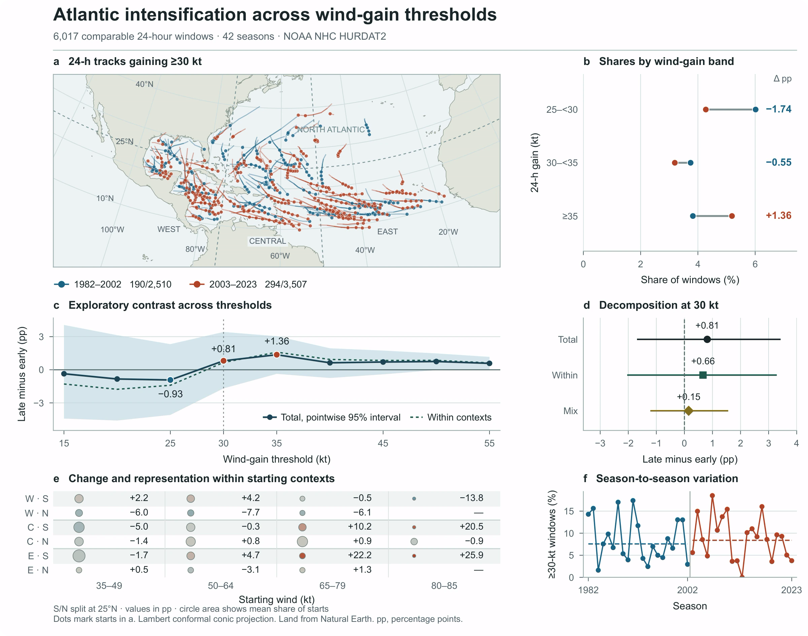

<h1 align="center">
  
</h1>

<p align="center">
  <a href="https://github.com/WUBING2023/PaperSpine/releases/download/v6.0.0-beta.2/paperspine-skill-6.0.0-beta.2.zip"><picture>
    <source media="(prefers-reduced-motion: reduce)" srcset="paperspine5/core/07_发布页/v6/readme/rounded/readme-ticker-still.webp">
    
  </picture></a>
</p>

<p align="center"><strong>Parte de una pregunta de investigación, datos o un borrador y obtén un artículo editable y verificable.</strong></p>

<p align="center">
  <a href="#install-with-ai"><strong>Inicio rápido</strong></a> · <a href="#quick-demo">Demostración</a> · <a href="#research-cases">Casos de investigación</a><br>
  <small><a href="https://wubing2023.github.io/PaperSpine/v6/">Sitio oficial</a> · <a href="INSTALL-V6.en.md">Guía de instalación</a> · <a href="#ways-to-work">Elegir una edición</a> · <a href="https://lauyanng.github.io/PaperSpine/">Atlas de la comunidad</a></small>
</p>

<p align="center">
  <a href="https://github.com/WUBING2023/PaperSpine/releases/tag/v6.0.0-beta.2"></a>
  <a href="https://github.com/WUBING2023/PaperSpine/stargazers"></a>
  <a href="LICENSE"></a>
  <a href="https://github.com/WUBING2023/PaperSpine/actions/workflows/validate.yml"></a>
  <a href="https://wubing2023.github.io/PaperSpine/contributors/"></a>
  <a href="https://github.com/WUBING2023/PaperSpine/issues?q=is%3Aissue+is%3Aclosed"></a>
  <a href="https://github.com/WUBING2023/PaperSpine/commits/main/"></a>
</p>

<p align="center">
  <sub>V6</sub>
  <a href="README.md"></a>
  <a href="README.zh-CN.md"></a>
  <a href="README.ja.md"></a>
  <a href="README.ko.md"></a>
  <a href="README.es.md"></a>
  <a href="README.fr.md"></a>
  <a href="README.de.md"></a>
  <a href="README.pt.md"></a>
  <a href="README.ru.md"></a>
</p>

<a id="quick-demo"></a>

## Redacta un artículo como lo haría un investigador

<p align="center">
  <picture>
    <source media="(prefers-reduced-motion: reduce)" srcset="paperspine5/core/07_发布页/v6/readme/rounded/paperspine_codex_demo_v3_15s-still.webp">
    
  </picture>
</p>

<p align="center"><small>Redacción guiada por referencias · Revisión de figuras · Vista previa del artículo · Revisión del mismo manuscrito</small></p>

<a id="workflow"></a>

## Cómo funciona PaperSpine

Usa artículos de referencia como modelo de redacción y la evidencia de tu estudio para sustentar las conclusiones.

<p align="center">
  <picture>
    <source media="(prefers-reduced-motion: reduce)" srcset="paperspine5/core/07_发布页/v6/readme/rounded/paperspine-workflow-8s-zh-still.webp">
    
  </picture>
</p>

<p align="center"><small>Investigación y recopilación de evidencia → Redacción guiada por referencias → Figuras editables → Revisión y entrega</small></p>

<a id="install-with-ai"></a>

## Instala PaperSpine con ayuda de la IA

Envía la siguiente instrucción al asistente de IA que estés usando.

```text
Instala PaperSpine en el entorno de IA que estoy usando. Lee primero la guía oficial de instalación.
https://wubing2023.github.io/PaperSpine/v6/llms.txt

Elige una edición que se adapte a mi uso y entorno, verifica el SHA-256 del ZIP y, después de instalarla, confirma la versión y explícame cómo invocar el Skill.
```

[Guía de instalación para la IA](https://wubing2023.github.io/PaperSpine/v6/llms.txt) · [Catálogo de versiones (JSON)](https://wubing2023.github.io/PaperSpine/v6/channel.json)

<a id="ways-to-work"></a>

## Tres formas de usar PaperSpine

<a id="start-with-skill"></a>

### Primeros pasos · Skill integral

Invoca `$paper-spine` en la conversación de tu aplicación de IA y dale el tema, los datos o el borrador. Según el alcance acordado, te entrega un registro de investigación, análisis, figuras científicas y un manuscrito editable.

[**Descargar ZIP**](https://github.com/WUBING2023/PaperSpine/releases/download/v6.0.0-beta.2/paperspine-skill-6.0.0-beta.2.zip) · 

### Investigación avanzada · Paquete de Skills

Usa `$paper-spine` para ejecutar el flujo completo o invoca cada etapa por separado. Por ejemplo, con `$paper-spine-followwriting` puedes reescribir una sección con tus propios resultados experimentales siguiendo la estructura argumentativa de un artículo de referencia.

[**Descargar ZIP**](https://github.com/WUBING2023/PaperSpine/releases/download/v6.0.0-beta.2/paperspine-skills-pack-6.0.0-beta.2.zip) · 

### Plugin completo · Espacio de trabajo web local

Puedes instalar el espacio de trabajo local para ampliar figuras, ver una vista previa del artículo o enviar comentarios de revisión en el navegador. Esta edición incluye todos los Skills. En Codex para Windows x64, invócala con `$paper-spine-web:paper-spine-web`.

[**Descargar ZIP**](https://github.com/WUBING2023/PaperSpine/releases/download/v6.0.0-beta.2/paperspine-web-plugin-6.0.0-beta.2-windows-x64.zip) · 

<details>
<summary><strong>Los cinco Skills por etapa y ejemplos de instrucciones</strong></summary>

| Skill | Ejemplo de instrucción |
| --- | --- |
| `$paper-spine-study` | Diseña un experimento pareado con estos datos y guarda los resultados de cada partición. |
| `$paper-spine-followwriting` | Ajusta la argumentación de la sección de resultados a partir de estos dos artículos de referencia. Conserva mis estimaciones y el alcance de mis conclusiones. |
| `$paper-spine-figures` | Crea figuras vectoriales con los resultados del análisis e incluye el código que las genera. |
| `$paper-spine-review` | Comprueba qué conclusiones respalda la evidencia, señala los puntos débiles y revisa el manuscrito. |
| `$paper-spine-deliver` | Entrega el manuscrito editable, una versión de lectura y los materiales de apoyo. |

</details>

<a id="installation"></a>

## Instalación, actualización y desinstalación

Verifica el SHA-256 del ZIP original con el archivo de sumas de comprobación. Descomprime el paquete y, desde la carpeta extraída, ejecuta el gestor incluido, indicando la ruta del ZIP original y el SHA-256 completo. Tras la instalación, abre una nueva conversación en tu aplicación de IA.

```text
python -B edition_manager.py install "<ruta del ZIP original>" --sha256 <SHA256>
```

El gestor requiere Python 3.12 o posterior. La edición web incluye Python para Windows y requiere Codex CLI. Permite buscar actualizaciones automáticamente, actualizar manualmente, volver a una versión anterior y desinstalar. Los artículos, datos y tareas locales se conservan.

[Instrucciones de instalación, actualización y desinstalación](INSTALL-V6.en.md) · [Archivo de sumas SHA-256](https://github.com/WUBING2023/PaperSpine/releases/download/v6.0.0-beta.2/checksums.sha256) · [Versión V6](https://github.com/WUBING2023/PaperSpine/releases/tag/v6.0.0-beta.2)

## Cómo incorpora PaperSpine la evidencia al artículo

- **Define el alcance del estudio con los materiales disponibles.** Si partes de una pregunta, identifica primero qué evidencia falta y qué análisis necesitas. Si ya tienes resultados, puedes pasar directamente a una figura, un argumento o una revisión específicos. Las etapas posteriores reutilizan los materiales y las decisiones guardados.
- **Rastrea las fuentes de la redacción y de la evidencia científica.** Followwriting conserva los pasajes de referencia que influyeron en la estructura y la redacción. La evidencia del estudio determina qué afirmaciones admite el artículo, que se entrega con análisis verificables, archivos fuente de las figuras y citas.
- **Aplica los comentarios al mismo manuscrito.** Guarda las figuras seleccionadas y los comentarios. Al revisar, retoma la misma tarea, vuelve a consultar la evidencia, modifica el manuscrito y las figuras afectadas y guarda un registro de los cambios.

El caso de LIGO permite seguir este recorrido directamente. Desde el orden de llegada descrito en el artículo puedes volver a las señales de deformación alineadas de ambos observatorios y a los resultados con nueve configuraciones de preprocesamiento. [Evidencia y archivos fuente de LIGO](https://wubing2023.github.io/PaperSpine/v6/#gravitational-waves)

<a id="research-cases"></a>

## Intensificación rápida de ciclones del Atlántico Norte

El Skill integral independiente analizó 42 temporadas ciclónicas de la NOAA. Entre 6017 ventanas comparables de 24 horas, con un umbral de 30 nudos, la proporción fue 0,81 puntos porcentuales mayor en el periodo más reciente. El intervalo del 95 % obtenido por remuestreo de temporadas ciclónicas fue de −1,69 a +3,43. Con un umbral de 25 nudos, la estimación puntual pasó a ser negativa. La figura de seis paneles reúne las trayectorias de 24 horas de 484 registros, tres intervalos no solapados de aumento de la velocidad del viento y las estimaciones puntuales y los intervalos para nueve umbrales.

<a href="https://wubing2023.github.io/PaperSpine/v6/#showcase"></a>

[Leer el artículo](https://wubing2023.github.io/PaperSpine/v6/science/research/atlantic-ri/paper.pdf) · [Figura principal en SVG](paperspine5/core/07_发布页/v6/science/research/atlantic-ri/figure.svg) · [Figura de robustez en SVG](paperspine5/core/07_发布页/v6/science/research/atlantic-ri/checks.svg) · [Manuscrito editable y código del análisis](https://wubing2023.github.io/PaperSpine/v6/science/research/atlantic-ri/source.zip)

En cada ficha puedes alternar entre la primera página del artículo, la página de resultados, la figura principal y la figura de robustez. [Abrir la galería de investigación](https://wubing2023.github.io/PaperSpine/v6/?v=research-gallery#showcase)

<a id="edition-field-test"></a>

## Tres estudios, tres modalidades

Los tres estudios se basan en datos públicos. Cada uno se ejecutó con GPT‑6.1 Sol en las tres modalidades, el Skill integral, los Skills por etapas y el espacio de trabajo web local. En total quedaron registradas [nueve ejecuciones de prueba](paperspine5/core/07_发布页/v6/science/research/README.md#how-the-runs-were-conducted). Cada estudio incluye el artículo, las figuras originales, el código para reproducir los cálculos y el registro de revisiones del mismo manuscrito.

[Consultar las páginas originales, las figuras principales y las pruebas de robustez](https://wubing2023.github.io/PaperSpine/v6/#showcase)

### Retardos de milisegundos en dos fusiones de agujeros negros

En dos eventos públicos de LIGO, la señal llegó a Hanford 7,36 y 7,75 milisegundos después que a Livingston, respectivamente. El signo del retardo se mantuvo con nueve configuraciones de preprocesamiento.

<a href="paperspine5/core/07_发布页/v6/science/research/gravitational-waves/figure.svg"></a>

[Leer el artículo](https://wubing2023.github.io/PaperSpine/v6/science/research/gravitational-waves/paper.pdf) · [Figura vectorial de alta calidad](paperspine5/core/07_发布页/v6/science/research/gravitational-waves/figure.svg) · [Manuscrito fuente y código](https://wubing2023.github.io/PaperSpine/v6/science/research/gravitational-waves/source.zip) · [Datos](https://doi.org/10.7935/82H3-HH23)

### La estimación del decaimiento de las réplicas depende del catálogo

Con los mismos criterios, entre 1 y 72 horas después del sismo principal de Mw 7,1 y con magnitudes registradas ≥1,5, los exponentes de decaimiento ajustados fueron 0,55 para ComCat y 0,48 para el catálogo relocalizado de Shelly.

<a href="paperspine5/core/07_发布页/v6/science/research/ridgecrest/figure.svg"></a>

[Leer el artículo](https://wubing2023.github.io/PaperSpine/v6/science/research/ridgecrest/paper.pdf) · [Figura vectorial de alta calidad](paperspine5/core/07_发布页/v6/science/research/ridgecrest/figure.svg) · [Manuscrito fuente y código](https://wubing2023.github.io/PaperSpine/v6/science/research/ridgecrest/source.zip) · [Datos](https://doi.org/10.5066/P9JN6H0N)

### Humo en junio, dos patrones regionales

Tomando como referencia la mediana de cada estación del 20 al 22 de junio, la diferencia en las desviaciones de PM₂.₅ entre la costa atlántica y los Grandes Lagos pasó de +74,1 µg/m³ del 6 al 8 de junio a −69,1 µg/m³ del 27 al 29 de junio.

<a href="paperspine5/core/07_发布页/v6/science/research/smoke/figure.svg"></a>

[Leer el artículo](https://wubing2023.github.io/PaperSpine/v6/science/research/smoke/paper.pdf) · [Figura vectorial de alta calidad](paperspine5/core/07_发布页/v6/science/research/smoke/figure.svg) · [Manuscrito fuente y código](https://wubing2023.github.io/PaperSpine/v6/science/research/smoke/source.zip) · [Datos](https://aqs.epa.gov/aqsweb/airdata/download_files.html)

[Evidencia de las tres modalidades](paperspine5/core/07_发布页/v6/science/research/README.md) · [Primeras pruebas de instalación](paperspine5/core/07_发布页/v6/science/edition-field-test.md)

<a id="paper-example"></a>
<a id="feature-demos"></a>

## Demostraciones animadas

<table><tr>
  <td width="50%"><a href="paperspine5/core/07_发布页/v6/science/followwriting-hd.gif"><picture>
    <source media="(prefers-reduced-motion: reduce)" srcset="paperspine5/core/07_发布页/v6/readme/rounded/followwriting-hd-still.webp">
    
  </picture></a><br><strong>Followwriting</strong></td>
  <td width="50%"><a href="paperspine5/core/07_发布页/v6/science/figures-hd.gif"><picture>
    <source media="(prefers-reduced-motion: reduce)" srcset="paperspine5/core/07_发布页/v6/readme/rounded/figures-hd-still.webp">
    
  </picture></a><br><strong>Revisión de figuras científicas</strong></td>
</tr><tr>
  <td width="50%"><a href="paperspine5/core/07_发布页/v6/science/workbench-hd.gif"><picture>
    <source media="(prefers-reduced-motion: reduce)" srcset="paperspine5/core/07_发布页/v6/readme/rounded/workbench-hd-still.webp">
    
  </picture></a><br><strong>Vista previa del artículo</strong></td>
  <td width="50%"><a href="paperspine5/core/07_发布页/v6/science/revision-hd.gif"><picture>
    <source media="(prefers-reduced-motion: reduce)" srcset="paperspine5/core/07_发布页/v6/readme/rounded/revision-hd-still.webp">
    
  </picture></a><br><strong>Evaluación y revisión</strong></td>
</tr></table>

El vídeo de Followwriting muestra cómo seguir un modelo de argumentación al redactar con los resultados de tu estudio. Los demás vídeos proceden del espacio de trabajo publicado para Windows. [Del comentario a la revisión](https://wubing2023.github.io/PaperSpine/v6/#revision) · [Capturas del espacio de trabajo a tamaño original](https://wubing2023.github.io/PaperSpine/v6/#examples)

## Desarrollo y comunidad

<a href="https://lauyanng.github.io/PaperSpine/"></a>

[Ver las contribuciones en cada actualización de V6](https://wubing2023.github.io/PaperSpine/contributors/#v6-contributions) · [Explorar el atlas de la comunidad](https://lauyanng.github.io/PaperSpine/)

[Sitio oficial en chino](https://wubing2023.github.io/PaperSpine/v6/) · [Código fuente de V6](paperspine5/core/01_PaperSpine4/src/skill-editions/) · [Gestor de instalación](paperspine5/core/06_插件化/release/edition_manager.py) · [Código fuente del sitio](paperspine5/core/07_发布页/v6/) · [Informar de un problema](https://github.com/WUBING2023/PaperSpine/issues) · <a id="press-kit"></a>[Materiales del proyecto](https://wubing2023.github.io/PaperSpine/v6/science/paperspine-v6-press-kit.zip)

<details>
<summary>Índice de documentación y código fuente de V5</summary>

- Métodos y materiales de trabajo · [writing_rationale_matrix](src/skill/references/rewrite.md) · [citation_support_bank](src/skill/references/citation-support-bank.md) · [translation_package](src/skill/references/translation-package.md)
- Herramientas de exportación y validación · [artifact_check.py](src/scripts/artifact_check.py) · [reference_inventory.py](src/scripts/reference_inventory.py) · [citation_bank_check.py](src/scripts/citation_bank_check.py) · [latex_guard.py](src/scripts/latex_guard.py) · [word_guard.py](src/scripts/word_guard.py)
- Integraciones anteriores con aplicaciones de IA · [Codex](dist/codex/skills/paper-spine/) · [Claude](dist/claude/skills/paper-spine/) · [OpenClaw](dist/openclaw/skills/paper-spine/) · [Claude command](dist/claude/commands/paperspine.md)
- Instaladores de V5 · [install.ps1](install.ps1) · [install.sh](install.sh)

[Archivo de V5](https://wubing2023.github.io/PaperSpine/v5/?legacy=1)

</details>

## Licencia

[MIT](LICENSE) · [Instrument Serif](paperspine5/core/07_发布页/v6/fonts/instrument-OFL.txt) · [Noto Serif SC](paperspine5/core/07_发布页/v6/fonts/notoserifsc-OFL.txt)
