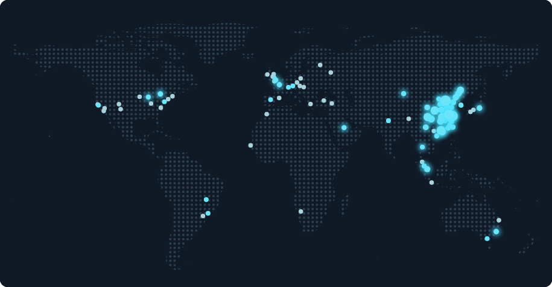

<h1 align="center">
  
</h1>

<p align="center">
  <a href="https://github.com/WUBING2023/PaperSpine/releases/download/v6.0.0-beta.2/paperspine-skill-6.0.0-beta.2.zip"><picture>
    <source media="(prefers-reduced-motion: reduce)" srcset="paperspine5/core/07_发布页/v6/readme/rounded/readme-ticker-still.webp">
    
  </picture></a>
</p>

<p align="center"><strong>Partez d’une question de recherche, de données ou d’un brouillon pour obtenir un article modifiable et vérifiable.</strong></p>

<p align="center">
  <a href="#install-with-ai"><strong>Démarrage rapide</strong></a> · <a href="#quick-demo">Démonstration</a> · <a href="#research-cases">Études de cas</a><br>
  <small><a href="https://wubing2023.github.io/PaperSpine/v6/">Site officiel</a> · <a href="INSTALL-V6.en.md">Guide d’installation</a> · <a href="#ways-to-work">Choisir une édition</a> · <a href="https://lauyanng.github.io/PaperSpine/">Atlas de la communauté</a></small>
</p>

<p align="center">
  <a href="https://github.com/WUBING2023/PaperSpine/releases/tag/v6.0.0-beta.2"></a>
  <a href="https://github.com/WUBING2023/PaperSpine/stargazers"></a>
  <a href="LICENSE"></a>
  <a href="https://github.com/WUBING2023/PaperSpine/actions/workflows/validate.yml"></a>
  <a href="https://wubing2023.github.io/PaperSpine/contributors/"></a>
  <a href="https://github.com/WUBING2023/PaperSpine/issues?q=is%3Aissue+is%3Aclosed"></a>
  <a href="https://github.com/WUBING2023/PaperSpine/commits/main/"></a>
</p>

<p align="center">
  <sub>V6</sub>
  <a href="README.md"></a>
  <a href="README.zh-CN.md"></a>
  <a href="README.ja.md"></a>
  <a href="README.ko.md"></a>
  <a href="README.es.md"></a>
  <a href="README.fr.md"></a>
  <a href="README.de.md"></a>
  <a href="README.pt.md"></a>
  <a href="README.ru.md"></a>
</p>

<a id="quick-demo"></a>

## Rédiger un article comme le ferait un chercheur

<p align="center">
  <picture>
    <source media="(prefers-reduced-motion: reduce)" srcset="paperspine5/core/07_发布页/v6/readme/rounded/paperspine_codex_demo_v3_15s-still.webp">
    
  </picture>
</p>

<p align="center"><small>Rédaction guidée par des références · Examen des figures · Aperçu de l’article · Révision du même manuscrit</small></p>

<a id="workflow"></a>

## Comment fonctionne PaperSpine

Inspirez-vous de la rédaction d’articles de référence et appuyez vos conclusions sur les éléments probants de votre étude.

<p align="center">
  <picture>
    <source media="(prefers-reduced-motion: reduce)" srcset="paperspine5/core/07_发布页/v6/readme/rounded/paperspine-workflow-8s-zh-still.webp">
    
  </picture>
</p>

<p align="center"><small>Recherche et collecte d’éléments probants → Rédaction guidée par des références → Figures modifiables → Relecture et livraison</small></p>

<a id="install-with-ai"></a>

## Installer PaperSpine avec l’aide de l’IA

Envoyez l’instruction ci-dessous à l’assistant IA que vous utilisez.

```text
Installe PaperSpine dans l’application d’IA que j’utilise actuellement. Lis d’abord le guide d’installation officiel.
https://wubing2023.github.io/PaperSpine/v6/llms.txt

Choisis une édition adaptée à mon usage et à mon environnement, vérifie le SHA-256 du ZIP et, après l’installation, confirme la version et indique-moi comment appeler le Skill.
```

[Guide d’installation pour l’IA](https://wubing2023.github.io/PaperSpine/v6/llms.txt) · [Catalogue des versions (JSON)](https://wubing2023.github.io/PaperSpine/v6/channel.json)

<a id="ways-to-work"></a>

## Trois façons d’utiliser PaperSpine

<a id="start-with-skill"></a>

### Premiers pas · Skill intégral

Appelez `$paper-spine` dans la conversation de votre application d’IA et fournissez un sujet, des données ou un brouillon. Selon le périmètre convenu, il livre un dossier de recherche, des analyses, des figures scientifiques et un manuscrit modifiable.

[**Télécharger le ZIP**](https://github.com/WUBING2023/PaperSpine/releases/download/v6.0.0-beta.2/paperspine-skill-6.0.0-beta.2.zip) · 

### Recherche avancée · Ensemble de Skills

Utilisez `$paper-spine` pour exécuter l’ensemble du processus ou appelez les étapes individuellement. Avec `$paper-spine-followwriting`, par exemple, vous pouvez réécrire une section à partir de vos propres résultats expérimentaux en vous inspirant de l’argumentation d’un article de référence.

[**Télécharger le ZIP**](https://github.com/WUBING2023/PaperSpine/releases/download/v6.0.0-beta.2/paperspine-skills-pack-6.0.0-beta.2.zip) · 

### Extension complète · Espace de travail web local

Installez l’espace de travail local si vous souhaitez agrandir les figures, prévisualiser l’article ou transmettre des commentaires de révision dans le navigateur. Cette édition comprend tous les Skills. Pour l’appeler dans Codex sous Windows x64, utilisez `$paper-spine-web:paper-spine-web`.

[**Télécharger le ZIP**](https://github.com/WUBING2023/PaperSpine/releases/download/v6.0.0-beta.2/paperspine-web-plugin-6.0.0-beta.2-windows-x64.zip) · 

<details>
<summary><strong>Les cinq Skills par étape et des exemples d’instructions</strong></summary>

| Skill | Exemple d’instruction |
| --- | --- |
| `$paper-spine-study` | Conçois une expérience appariée avec ces données et enregistre les résultats de chaque partition. |
| `$paper-spine-followwriting` | Inspire-toi de ces deux articles de référence pour retravailler l’argumentation de la section Résultats. Conserve mes estimations et la portée de mes conclusions. |
| `$paper-spine-figures` | Crée des figures vectorielles à partir des résultats de l’analyse et joins le code qui les génère. |
| `$paper-spine-review` | Vérifie quelles conclusions sont étayées par les éléments probants, signale les points faibles et révise le manuscrit. |
| `$paper-spine-deliver` | Livre le manuscrit modifiable, une version de lecture et les documents à l’appui. |

</details>

<a id="installation"></a>

## Installation, mise à jour et désinstallation

Vérifiez le SHA-256 du ZIP original à l’aide du fichier de sommes de contrôle. Décompressez le paquet et, depuis le dossier extrait, exécutez le gestionnaire fourni en indiquant le chemin du ZIP original et le SHA-256 complet. Après l’installation, ouvrez une nouvelle conversation dans votre application d’IA.

```text
python -B edition_manager.py install "<chemin du ZIP original>" --sha256 <SHA256>
```

Le gestionnaire nécessite Python 3.12 ou une version ultérieure. L’édition web inclut Python pour Windows et nécessite Codex CLI. Elle permet de vérifier automatiquement la disponibilité de mises à jour, de les installer manuellement, de revenir à une version antérieure et de désinstaller le produit. Les articles, les données et les tâches locales sont conservés.

[Instructions d’installation, de mise à jour et de désinstallation](INSTALL-V6.en.md) · [Fichier de sommes SHA-256](https://github.com/WUBING2023/PaperSpine/releases/download/v6.0.0-beta.2/checksums.sha256) · [Version V6](https://github.com/WUBING2023/PaperSpine/releases/tag/v6.0.0-beta.2)

## Comment PaperSpine relie l’article aux éléments probants

- **Définissez le périmètre de l’étude à partir des éléments disponibles.** Si vous partez d’une question, déterminez d’abord quels éléments probants manquent et quelles analyses sont nécessaires. Si vous avez déjà des résultats, vous pouvez passer directement à la figure, à l’argumentation ou à la relecture demandée. Les étapes suivantes réutilisent les éléments et les décisions enregistrés.
- **Retracez les sources de la rédaction et des éléments probants.** Followwriting conserve les passages de référence qui ont influencé la structure et la formulation. Les éléments probants de l’étude déterminent ce que l’article peut affirmer. Le manuscrit est livré avec des analyses vérifiables, les fichiers sources des figures et les citations.
- **Révisez le même manuscrit à partir des commentaires.** Enregistrez les figures sélectionnées et les commentaires. Pour la révision, reprenez la même tâche, consultez les éléments probants, modifiez le manuscrit et les figures concernées, puis conservez un historique des modifications.

Le cas LIGO permet de remonter directement aux sources. À partir de l’ordre d’arrivée présenté dans l’article, retrouvez les signaux de déformation alignés des deux observatoires et les résultats des neuf configurations de prétraitement. [Éléments probants et fichiers sources de LIGO](https://wubing2023.github.io/PaperSpine/v6/#gravitational-waves)

<a id="research-cases"></a>

## Intensification rapide des cyclones de l’Atlantique Nord

Le Skill intégral autonome a analysé 42 saisons cycloniques de la NOAA. Sur 6 017 fenêtres comparables de 24 heures, avec un seuil de 30 nœuds, la proportion était supérieure de 0,81 point de pourcentage sur la période la plus récente. L’intervalle à 95 % obtenu par rééchantillonnage des saisons cycloniques allait de −1,69 à +3,43. Avec un seuil de 25 nœuds, l’estimation ponctuelle est devenue négative. La figure en six panneaux réunit les trajectoires sur 24 heures de 484 relevés, trois classes non chevauchantes d’augmentation de la vitesse du vent, ainsi que les estimations ponctuelles et les intervalles pour neuf seuils.

<a href="https://wubing2023.github.io/PaperSpine/v6/#showcase"></a>

[Lire l’article](https://wubing2023.github.io/PaperSpine/v6/science/research/atlantic-ri/paper.pdf) · [Figure principale en SVG](paperspine5/core/07_发布页/v6/science/research/atlantic-ri/figure.svg) · [Figure de robustesse en SVG](paperspine5/core/07_发布页/v6/science/research/atlantic-ri/checks.svg) · [Manuscrit modifiable et code d’analyse](https://wubing2023.github.io/PaperSpine/v6/science/research/atlantic-ri/source.zip)

Chaque fiche permet de consulter la première page de l’article, la page de résultats, la figure principale et la figure de robustesse. [Ouvrir la galerie des travaux de recherche](https://wubing2023.github.io/PaperSpine/v6/?v=research-gallery#showcase)

<a id="edition-field-test"></a>

## Trois études, trois modes

Les trois études s’appuient sur des données publiques. Chacune a été exécutée avec GPT‑6.1 Sol dans les trois modes, avec le Skill intégral, les Skills par étape et l’espace de travail web local, pour un total de [neuf essais documentés](paperspine5/core/07_发布页/v6/science/research/README.md#how-the-runs-were-conducted). Chaque étude comprend l’article, les figures originales, le code pour reproduire les calculs et l’historique des révisions du même manuscrit.

[Consulter les pages originales, les figures principales et les tests de robustesse](https://wubing2023.github.io/PaperSpine/v6/#showcase)

### Retards de quelques millisecondes lors de deux fusions de trous noirs

Pour deux événements publics de LIGO, les signaux sont arrivés à Hanford respectivement 7,36 et 7,75 millisecondes après Livingston. Le signe du retard est resté le même dans les neuf configurations de prétraitement.

<a href="paperspine5/core/07_发布页/v6/science/research/gravitational-waves/figure.svg"></a>

[Lire l’article](https://wubing2023.github.io/PaperSpine/v6/science/research/gravitational-waves/paper.pdf) · [Figure vectorielle haute définition](paperspine5/core/07_发布页/v6/science/research/gravitational-waves/figure.svg) · [Manuscrit source et code](https://wubing2023.github.io/PaperSpine/v6/science/research/gravitational-waves/source.zip) · [Données](https://doi.org/10.7935/82H3-HH23)

### L’estimation de la décroissance des répliques varie selon le catalogue

Avec les mêmes critères, entre 1 et 72 heures après le séisme principal de Mw 7,1 et pour les magnitudes déclarées ≥1,5, les exposants de décroissance ajustés sont de 0,55 pour ComCat et de 0,48 pour le catalogue relocalisé de Shelly.

<a href="paperspine5/core/07_发布页/v6/science/research/ridgecrest/figure.svg"></a>

[Lire l’article](https://wubing2023.github.io/PaperSpine/v6/science/research/ridgecrest/paper.pdf) · [Figure vectorielle haute définition](paperspine5/core/07_发布页/v6/science/research/ridgecrest/figure.svg) · [Manuscrit source et code](https://wubing2023.github.io/PaperSpine/v6/science/research/ridgecrest/source.zip) · [Données](https://doi.org/10.5066/P9JN6H0N)

### Fumées de juin, deux profils régionaux

En prenant comme référence la médiane de chaque station du 20 au 22 juin, la différence entre les écarts de PM₂.₅ de la côte atlantique et ceux des Grands Lacs est passée de +74,1 µg/m³ du 6 au 8 juin à −69,1 µg/m³ du 27 au 29 juin.

<a href="paperspine5/core/07_发布页/v6/science/research/smoke/figure.svg"></a>

[Lire l’article](https://wubing2023.github.io/PaperSpine/v6/science/research/smoke/paper.pdf) · [Figure vectorielle haute définition](paperspine5/core/07_发布页/v6/science/research/smoke/figure.svg) · [Manuscrit source et code](https://wubing2023.github.io/PaperSpine/v6/science/research/smoke/source.zip) · [Données](https://aqs.epa.gov/aqsweb/airdata/download_files.html)

[Éléments probants pour les trois modes](paperspine5/core/07_发布页/v6/science/research/README.md) · [Premiers essais d’installation](paperspine5/core/07_发布页/v6/science/edition-field-test.md)

<a id="paper-example"></a>
<a id="feature-demos"></a>

## Démonstrations animées

<table><tr>
  <td width="50%"><a href="paperspine5/core/07_发布页/v6/science/followwriting-hd.gif"><picture>
    <source media="(prefers-reduced-motion: reduce)" srcset="paperspine5/core/07_发布页/v6/readme/rounded/followwriting-hd-still.webp">
    
  </picture></a><br><strong>Followwriting</strong></td>
  <td width="50%"><a href="paperspine5/core/07_发布页/v6/science/figures-hd.gif"><picture>
    <source media="(prefers-reduced-motion: reduce)" srcset="paperspine5/core/07_发布页/v6/readme/rounded/figures-hd-still.webp">
    
  </picture></a><br><strong>Examen des figures scientifiques</strong></td>
</tr><tr>
  <td width="50%"><a href="paperspine5/core/07_发布页/v6/science/workbench-hd.gif"><picture>
    <source media="(prefers-reduced-motion: reduce)" srcset="paperspine5/core/07_发布页/v6/readme/rounded/workbench-hd-still.webp">
    
  </picture></a><br><strong>Aperçu de l’article</strong></td>
  <td width="50%"><a href="paperspine5/core/07_发布页/v6/science/revision-hd.gif"><picture>
    <source media="(prefers-reduced-motion: reduce)" srcset="paperspine5/core/07_发布页/v6/readme/rounded/revision-hd-still.webp">
    
  </picture></a><br><strong>Relecture et révision</strong></td>
</tr></table>

La vidéo de Followwriting montre comment s’inspirer d’un modèle d’argumentation tout en rédigeant à partir des résultats de l’étude. Les autres séquences proviennent de l’espace de travail publié pour Windows. [Des commentaires à la révision](https://wubing2023.github.io/PaperSpine/v6/#revision) · [Captures de l’espace de travail à taille réelle](https://wubing2023.github.io/PaperSpine/v6/#examples)

## Développement et communauté

<a href="https://lauyanng.github.io/PaperSpine/"></a>

[Voir les contributions à chaque mise à jour de la V6](https://wubing2023.github.io/PaperSpine/contributors/#v6-contributions) · [Explorer l’atlas de la communauté](https://lauyanng.github.io/PaperSpine/)

[Site officiel en chinois](https://wubing2023.github.io/PaperSpine/v6/) · [Code source de la V6](paperspine5/core/01_PaperSpine4/src/skill-editions/) · [Gestionnaire d’installation](paperspine5/core/06_插件化/release/edition_manager.py) · [Code source du site](paperspine5/core/07_发布页/v6/) · [Signaler un problème](https://github.com/WUBING2023/PaperSpine/issues) · <a id="press-kit"></a>[Ressources du projet](https://wubing2023.github.io/PaperSpine/v6/science/paperspine-v6-press-kit.zip)

<details>
<summary>Index de la documentation et du code source de la V5</summary>

- Méthodes et documents de travail · [writing_rationale_matrix](src/skill/references/rewrite.md) · [citation_support_bank](src/skill/references/citation-support-bank.md) · [translation_package](src/skill/references/translation-package.md)
- Outils d’exportation et de validation · [artifact_check.py](src/scripts/artifact_check.py) · [reference_inventory.py](src/scripts/reference_inventory.py) · [citation_bank_check.py](src/scripts/citation_bank_check.py) · [latex_guard.py](src/scripts/latex_guard.py) · [word_guard.py](src/scripts/word_guard.py)
- Anciennes intégrations dans les applications d’IA · [Codex](dist/codex/skills/paper-spine/) · [Claude](dist/claude/skills/paper-spine/) · [OpenClaw](dist/openclaw/skills/paper-spine/) · [Claude command](dist/claude/commands/paperspine.md)
- Programmes d’installation de la V5 · [install.ps1](install.ps1) · [install.sh](install.sh)

[Archives de la V5](https://wubing2023.github.io/PaperSpine/v5/?legacy=1)

</details>

## Licence

[MIT](LICENSE) · [Instrument Serif](paperspine5/core/07_发布页/v6/fonts/instrument-OFL.txt) · [Noto Serif SC](paperspine5/core/07_发布页/v6/fonts/notoserifsc-OFL.txt)
