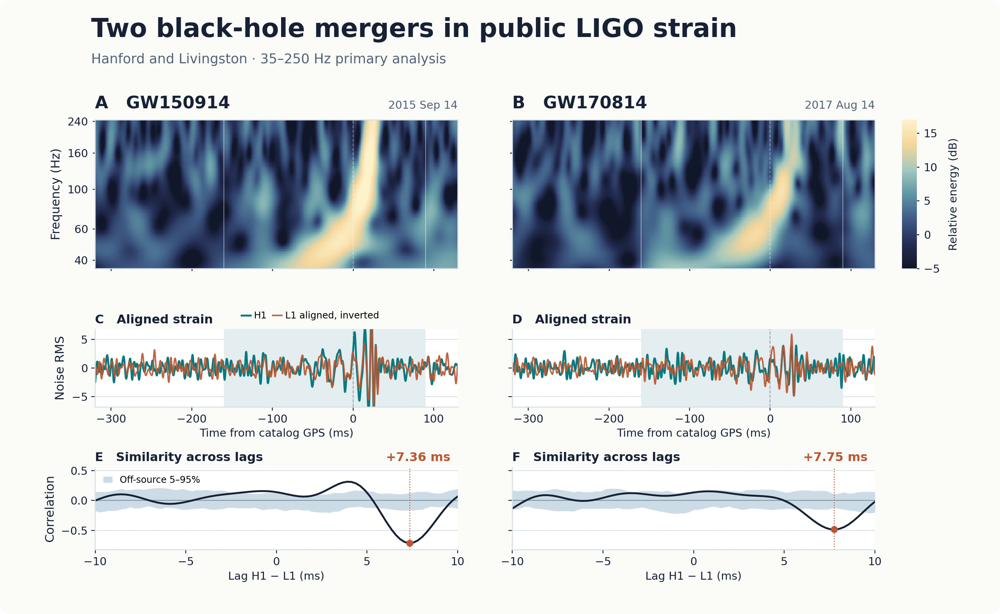
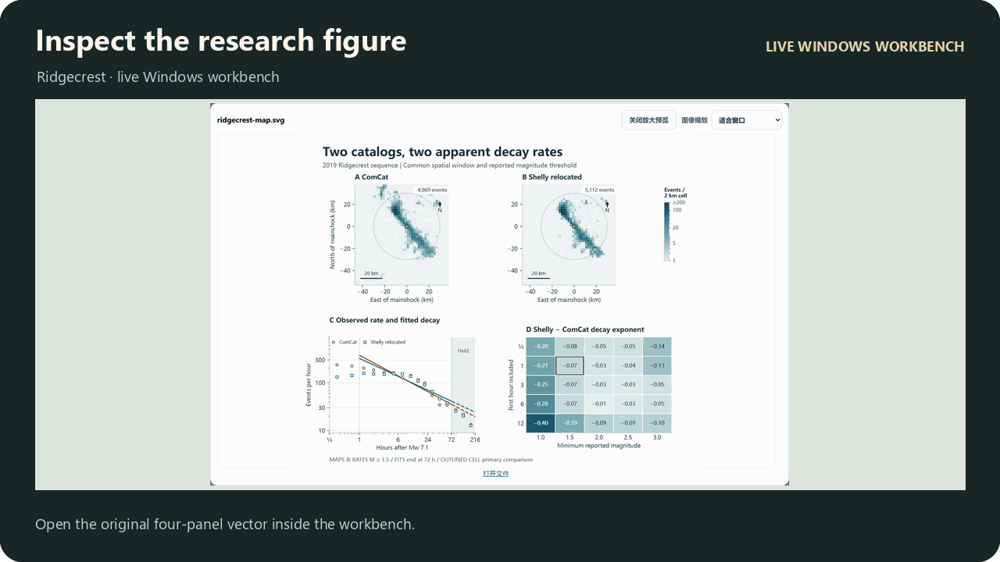

<h1 align="center">
  
</h1>

<p align="center">
  <a href="https://github.com/WUBING2023/PaperSpine/releases/download/v6.0.0-beta.2/paperspine-skill-6.0.0-beta.2.zip"><picture>
    <source media="(prefers-reduced-motion: reduce)" srcset="paperspine5/core/07_发布页/v6/readme/rounded/readme-ticker-still.webp">
    
  </picture></a>
</p>

<p align="center"><strong>연구 질문, 데이터 또는 초안에서 시작해 편집하고 검증할 수 있는 논문을 완성합니다.</strong></p>

<p align="center">
  <a href="#install-with-ai"><strong>빠른 시작</strong></a> · <a href="#quick-demo">데모</a> · <a href="#research-cases">연구 사례</a><br>
  <small><a href="https://wubing2023.github.io/PaperSpine/v6/">공식 사이트</a> · <a href="INSTALL-V6.en.md">설치 가이드</a> · <a href="#ways-to-work">에디션 선택</a> · <a href="https://lauyanng.github.io/PaperSpine/">커뮤니티 지도</a></small>
</p>

<p align="center">
  <a href="https://github.com/WUBING2023/PaperSpine/releases/tag/v6.0.0-beta.2"></a>
  <a href="https://github.com/WUBING2023/PaperSpine/stargazers"></a>
  <a href="LICENSE"></a>
  <a href="https://github.com/WUBING2023/PaperSpine/actions/workflows/validate.yml"></a>
  <a href="https://wubing2023.github.io/PaperSpine/contributors/"></a>
  <a href="https://github.com/WUBING2023/PaperSpine/issues?q=is%3Aissue+is%3Aclosed"></a>
  <a href="https://github.com/WUBING2023/PaperSpine/commits/main/"></a>
</p>

<p align="center">
  <sub>V6</sub>
  <a href="README.md"></a>
  <a href="README.zh-CN.md"></a>
  <a href="README.ja.md"></a>
  <a href="README.ko.md"></a>
  <a href="README.es.md"></a>
  <a href="README.fr.md"></a>
  <a href="README.de.md"></a>
  <a href="README.pt.md"></a>
  <a href="README.ru.md"></a>
</p>

<a id="quick-demo"></a>

## 연구자처럼 논문 완성하기

<p align="center">
  <picture>
    <source media="(prefers-reduced-motion: reduce)" srcset="paperspine5/core/07_发布页/v6/readme/rounded/paperspine_codex_demo_v3_15s-still.webp">
    
  </picture>
</p>

<p align="center"><small>참고 논문을 활용한 집필 · 그림 검토 · 논문 미리보기 · 같은 원고 수정</small></p>

<a id="workflow"></a>

## PaperSpine의 작동 방식

참고 논문에서 글쓰기 방식을 배우고, 결론은 내 연구의 근거로 뒷받침합니다.

<p align="center">
  <picture>
    <source media="(prefers-reduced-motion: reduce)" srcset="paperspine5/core/07_发布页/v6/readme/rounded/paperspine-workflow-8s-zh-still.webp">
    
  </picture>
</p>

<p align="center"><small>조사 및 근거 수집 → 참고 논문을 활용한 집필 → 편집 가능한 그림 제작 → 검토 및 결과물 전달</small></p>

<a id="install-with-ai"></a>

## AI에게 설치 요청하기

아래 지시문을 사용 중인 AI 어시스턴트에 보내세요.

```text
지금 사용 중인 AI 환경에 PaperSpine을 설치해 주세요. 먼저 공식 설치 가이드를 읽어 주세요.
https://wubing2023.github.io/PaperSpine/v6/llms.txt

제 용도와 환경에 맞는 에디션을 선택하고 ZIP의 SHA-256을 대조해 주세요. 설치 후 버전을 확인하고 Skill을 호출하는 방법을 알려 주세요.
```

[AI용 설치 가이드](https://wubing2023.github.io/PaperSpine/v6/llms.txt) · [에디션 목록(JSON)](https://wubing2023.github.io/PaperSpine/v6/channel.json)

<a id="ways-to-work"></a>

## 세 가지 사용 방법

<a id="start-with-skill"></a>

### 처음 시작한다면 · 전체 워크플로 Skill

AI 환경의 대화에서 `$paper-spine`을 호출한 뒤 연구 주제, 데이터 또는 초안을 제공하세요. 합의한 범위에 맞춰 연구 기록, 분석, 연구 그림, 편집 가능한 원고를 제공합니다.

[**ZIP 다운로드**](https://github.com/WUBING2023/PaperSpine/releases/download/v6.0.0-beta.2/paperspine-skill-6.0.0-beta.2.zip) · 

### 연구자용 · Skills 팩

`$paper-spine`으로 전체 워크플로를 실행하거나 각 단계의 Skill을 개별적으로 호출할 수 있습니다. 예를 들어 `$paper-spine-followwriting`을 쓰면 참고 논문의 논증 방식을 따라 자신의 실험 결과로 논문 한 섹션을 다시 쓸 수 있습니다.

[**ZIP 다운로드**](https://github.com/WUBING2023/PaperSpine/releases/download/v6.0.0-beta.2/paperspine-skills-pack-6.0.0-beta.2.zip) · 

### 전체 기능 플러그인 · 로컬 웹 워크벤치

브라우저에서 그림을 확대하거나 논문을 미리 보거나 원고 수정 의견을 제출하려면 로컬 워크벤치를 추가 설치할 수 있습니다. 모든 Skills가 포함되어 있으며 Windows x64의 Codex에서 `$paper-spine-web:paper-spine-web`을 호출해 사용합니다.

[**ZIP 다운로드**](https://github.com/WUBING2023/PaperSpine/releases/download/v6.0.0-beta.2/paperspine-web-plugin-6.0.0-beta.2-windows-x64.zip) · 

<details>
<summary><strong>5개 단계별 Skill과 지시문 예시</strong></summary>

| Skill | 지시문 예시 |
| --- | --- |
| `$paper-spine-study` | 이 데이터로 짝지은 실험을 설계하고 데이터 분할별 결과를 저장해 주세요. |
| `$paper-spine-followwriting` | 이 두 편의 참고 논문을 바탕으로 Results의 논증을 다듬고, 제 추정값과 결론의 범위는 유지해 주세요. |
| `$paper-spine-figures` | 분석 결과를 벡터 그림으로 만들고 생성 코드를 첨부해 주세요. |
| `$paper-spine-review` | 근거가 뒷받침하는 결론을 확인하고, 근거가 부족한 부분을 짚어 수정해 주세요. |
| `$paper-spine-deliver` | 편집용 원고, 열람용 원고, 근거 자료를 제공해 주세요. |

</details>

<a id="installation"></a>

## 설치, 업데이트 및 제거

먼저 체크섬 목록에서 원본 ZIP의 SHA-256을 대조하세요. 압축을 푼 디렉터리에서 동봉된 관리자를 실행하고 원본 ZIP의 경로와 전체 SHA-256 값을 입력하세요. 설치를 마치면 AI 환경에서 새 대화를 여세요.

```text
python -B edition_manager.py install "<원본 ZIP 경로>" --sha256 <SHA256>
```

설치 관리자에는 Python 3.12 이상이 필요합니다. 웹 에디션에는 Windows용 Python이 포함되어 있으며 Codex CLI도 필요합니다. 자동 업데이트 확인, 수동 업그레이드, 롤백, 제거를 지원하며 논문, 데이터, 로컬 작업을 보존합니다.

[설치, 업데이트 및 제거 가이드](INSTALL-V6.en.md) · [SHA-256 체크섬 파일](https://github.com/WUBING2023/PaperSpine/releases/download/v6.0.0-beta.2/checksums.sha256) · [V6 릴리스](https://github.com/WUBING2023/PaperSpine/releases/tag/v6.0.0-beta.2)

## PaperSpine이 논문에 연구 근거를 반영하는 방법

- **보유한 자료를 토대로 연구 범위를 정합니다.** 연구 질문만 있다면 어떤 근거를 보완하고 어떤 분석을 할지 먼저 정합니다. 결과가 이미 있다면 필요한 그림 제작, 논증 구성 또는 검토부터 진행할 수 있습니다. 다음 단계에서는 저장된 자료와 결정 사항을 이어서 사용합니다.
- **글쓰기 참고 자료와 과학적 근거의 출처를 기록합니다.** Followwriting은 원고 구성과 표현에 영향을 준 참고 논문의 원문을 보존합니다. 논문이 주장할 수 있는 범위는 이 연구의 근거로 정하며, 검증 가능한 분석, 그림 원본 파일, 인용 문헌을 원고에 첨부합니다.
- **검토 의견을 같은 원고에 반영합니다.** 선택한 그림과 피드백을 저장합니다. 수정할 때 같은 작업에서 근거를 다시 확인하고, 원고와 수정의 영향을 받는 그림을 갱신하며 변경 이력을 남깁니다.

LIGO 사례에서 이 과정을 직접 확인할 수 있습니다. 논문에 나온 신호 도착 순서에서 두 관측소의 시간축을 맞춘 변형률 데이터와 9가지 전처리 결과까지 거슬러 확인할 수 있습니다. [LIGO 근거와 원본 파일](https://wubing2023.github.io/PaperSpine/v6/#gravitational-waves)

<a id="research-cases"></a>

## 북대서양 열대저기압의 급격한 강화

독립형 전체 워크플로 Skill을 사용해 NOAA의 열대저기압 데이터 42개 시즌을 분석했습니다. 비교 가능한 24시간 구간 6,017개에서 기준을 30노트로 두면 후기 비율이 0.81%포인트 높았으며, 시즌 단위로 재표집한 95% 구간은 −1.69에서 +3.43이었습니다. 기준을 25노트로 바꾸면 점추정치가 음수로 바뀌었습니다. 6개 패널에는 484개 기록의 24시간 궤적, 서로 겹치지 않는 3개 풍속 증가 구간, 9개 기준값별 점추정치와 구간이 담겨 있습니다.

<a href="https://wubing2023.github.io/PaperSpine/v6/#showcase"></a>

[논문 읽기](https://wubing2023.github.io/PaperSpine/v6/science/research/atlantic-ri/paper.pdf) · [주요 그림(SVG)](paperspine5/core/07_发布页/v6/science/research/atlantic-ri/figure.svg) · [강건성 검증 그림(SVG)](paperspine5/core/07_发布页/v6/science/research/atlantic-ri/checks.svg) · [편집 가능한 원고와 분석 코드](https://wubing2023.github.io/PaperSpine/v6/science/research/atlantic-ri/source.zip)

연구 카드를 전환하고 논문 첫 페이지, 결과 페이지, 주요 그림, 강건성 검증 그림을 번갈아 볼 수 있습니다. [연구 성과 갤러리 열기](https://wubing2023.github.io/PaperSpine/v6/?v=research-gallery#showcase)

<a id="edition-field-test"></a>

## 연구 3건을 3가지 모드로 실행

각 연구는 공개 데이터를 사용했습니다. GPT‑6.1 Sol로 전체 워크플로 Skill, 단계별 Skills, 로컬 웹 워크벤치를 각각 한 번씩 실행해 [총 9회의 실행 기록](paperspine5/core/07_发布页/v6/science/research/README.md#how-the-runs-were-conducted)을 남겼습니다. 각 연구에는 논문, 그림 원본, 결과를 재계산할 수 있는 코드, 같은 원고의 수정 이력이 포함됩니다.

[논문 원본 페이지, 주요 그림, 강건성 검증 전환해 보기](https://wubing2023.github.io/PaperSpine/v6/#showcase)

### 두 차례 블랙홀 병합의 밀리초 단위 도착 시간차

공개된 LIGO 이벤트 2건에서 핸퍼드에는 리빙스턴보다 신호가 각각 7.36밀리초와 7.75밀리초 늦게 도착했습니다. 9가지 전처리 설정 모두에서 도착 순서가 같았습니다.

<a href="paperspine5/core/07_发布页/v6/science/research/gravitational-waves/figure.svg"></a>

[논문 읽기](https://wubing2023.github.io/PaperSpine/v6/science/research/gravitational-waves/paper.pdf) · [고해상도 벡터 그림](paperspine5/core/07_发布页/v6/science/research/gravitational-waves/figure.svg) · [원고 원본과 코드](https://wubing2023.github.io/PaperSpine/v6/science/research/gravitational-waves/source.zip) · [데이터](https://doi.org/10.7935/82H3-HH23)

### 여진의 감쇠 추정치는 지진 목록에 따라 달라진다

Mw 7.1 본진 이후 1–72시간, 보고 규모 ≥1.5라는 동일 조건에서 ComCat과 Shelly 진원 재결정 목록에 적합한 감쇠 지수는 각각 0.55와 0.48이었습니다.

<a href="paperspine5/core/07_发布页/v6/science/research/ridgecrest/figure.svg"></a>

[논문 읽기](https://wubing2023.github.io/PaperSpine/v6/science/research/ridgecrest/paper.pdf) · [고해상도 벡터 그림](paperspine5/core/07_发布页/v6/science/research/ridgecrest/figure.svg) · [원고 원본과 코드](https://wubing2023.github.io/PaperSpine/v6/science/research/ridgecrest/source.zip) · [데이터](https://doi.org/10.5066/P9JN6H0N)

### 6월 연무에서 나타난 두 가지 지역 분포

각 관측소의 6월 20–22일 중앙값을 기준으로 삼았을 때, 대서양 연안과 오대호 지역의 PM₂.₅ 편차 차이는 6월 6–8일의 +74.1에서 6월 27–29일의 −69.1 µg/m³로 반전됐습니다.

<a href="paperspine5/core/07_发布页/v6/science/research/smoke/figure.svg"></a>

[논문 읽기](https://wubing2023.github.io/PaperSpine/v6/science/research/smoke/paper.pdf) · [고해상도 벡터 그림](paperspine5/core/07_发布页/v6/science/research/smoke/figure.svg) · [원고 원본과 코드](https://wubing2023.github.io/PaperSpine/v6/science/research/smoke/source.zip) · [데이터](https://aqs.epa.gov/aqsweb/airdata/download_files.html)

[3가지 모드의 실행 기록과 근거 자료](paperspine5/core/07_发布页/v6/science/research/README.md) · [초기 설치 시험](paperspine5/core/07_发布页/v6/science/edition-field-test.md)

<a id="paper-example"></a>
<a id="feature-demos"></a>

## 기능 데모

<table><tr>
  <td width="50%"><a href="paperspine5/core/07_发布页/v6/science/followwriting-hd.gif"><picture>
    <source media="(prefers-reduced-motion: reduce)" srcset="paperspine5/core/07_发布页/v6/readme/rounded/followwriting-hd-still.webp">
    
  </picture></a><br><strong>Followwriting</strong></td>
  <td width="50%"><a href="paperspine5/core/07_发布页/v6/science/figures-hd.gif"><picture>
    <source media="(prefers-reduced-motion: reduce)" srcset="paperspine5/core/07_发布页/v6/readme/rounded/figures-hd-still.webp">
    
  </picture></a><br><strong>연구 그림 검토</strong></td>
</tr><tr>
  <td width="50%"><a href="paperspine5/core/07_发布页/v6/science/workbench-hd.gif"><picture>
    <source media="(prefers-reduced-motion: reduce)" srcset="paperspine5/core/07_发布页/v6/readme/rounded/workbench-hd-still.webp">
    
  </picture></a><br><strong>논문 미리보기</strong></td>
  <td width="50%"><a href="paperspine5/core/07_发布页/v6/science/revision-hd.gif"><picture>
    <source media="(prefers-reduced-motion: reduce)" srcset="paperspine5/core/07_发布页/v6/readme/rounded/revision-hd-still.webp">
    
  </picture></a><br><strong>검토와 수정</strong></td>
</tr></table>

짧은 Followwriting 데모에서는 참고 논문의 논증 방식을 살펴보고 자기 연구 결과를 바탕으로 글을 쓰는 과정을 보여 줍니다. 나머지 데모는 공개된 Windows 워크벤치에서 촬영했습니다. [피드백부터 수정까지 과정 보기](https://wubing2023.github.io/PaperSpine/v6/#revision) · [워크벤치 원본 크기 화면](https://wubing2023.github.io/PaperSpine/v6/#examples)

## 개발과 커뮤니티

<a href="https://lauyanng.github.io/PaperSpine/"></a>

[V6 업데이트별 기여 내역 보기](https://wubing2023.github.io/PaperSpine/contributors/#v6-contributions) · [커뮤니티 지도 보기](https://lauyanng.github.io/PaperSpine/)

[공식 사이트](https://wubing2023.github.io/PaperSpine/v6/) · [V6 소스 코드](paperspine5/core/01_PaperSpine4/src/skill-editions/) · [설치 관리자](paperspine5/core/06_插件化/release/edition_manager.py) · [공식 사이트 소스 코드](paperspine5/core/07_发布页/v6/) · [이슈 제보](https://github.com/WUBING2023/PaperSpine/issues) · <a id="press-kit"></a>[프로젝트 자료](https://wubing2023.github.io/PaperSpine/v6/science/paperspine-v6-press-kit.zip)

<details>
<summary>V5 문서 및 소스 코드 색인</summary>

- 방법 및 작업용 파일 · [writing_rationale_matrix](src/skill/references/rewrite.md) · [citation_support_bank](src/skill/references/citation-support-bank.md) · [translation_package](src/skill/references/translation-package.md)
- 내보내기 및 검증 도구 · [artifact_check.py](src/scripts/artifact_check.py) · [reference_inventory.py](src/scripts/reference_inventory.py) · [citation_bank_check.py](src/scripts/citation_bank_check.py) · [latex_guard.py](src/scripts/latex_guard.py) · [word_guard.py](src/scripts/word_guard.py)
- 이전 버전의 AI 환경별 배포 파일 · [Codex](dist/codex/skills/paper-spine/) · [Claude](dist/claude/skills/paper-spine/) · [OpenClaw](dist/openclaw/skills/paper-spine/) · [Claude command](dist/claude/commands/paperspine.md)
- V5 설치 프로그램 · [install.ps1](install.ps1) · [install.sh](install.sh)

[V5 아카이브](https://wubing2023.github.io/PaperSpine/v5/?legacy=1)

</details>

## 라이선스

[MIT](LICENSE) · [Instrument Serif](paperspine5/core/07_发布页/v6/fonts/instrument-OFL.txt) · [Noto Serif SC](paperspine5/core/07_发布页/v6/fonts/notoserifsc-OFL.txt)
