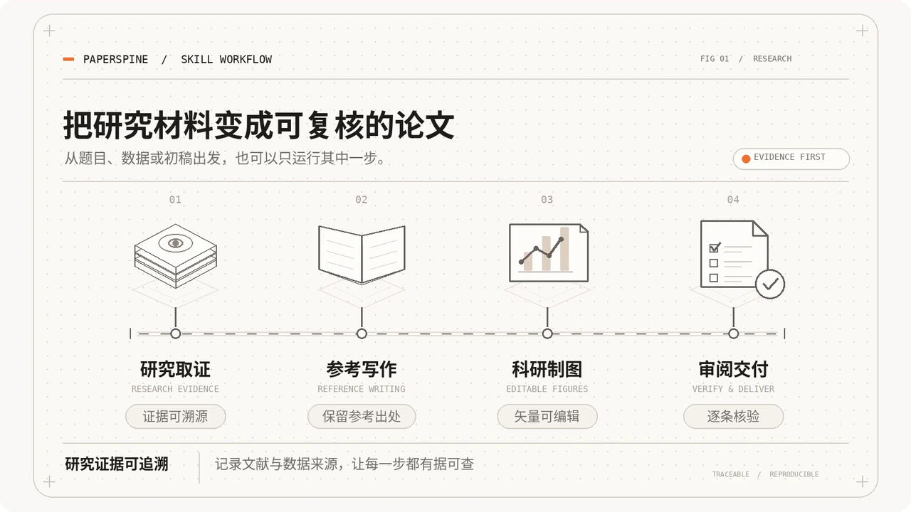

<h1 align="center">
  
</h1>

<p align="center">
  <a href="https://github.com/WUBING2023/PaperSpine/releases/download/v6.0.0-beta.2/paperspine-skill-6.0.0-beta.2.zip"><picture>
    <source media="(prefers-reduced-motion: reduce)" srcset="paperspine5/core/07_发布页/v6/readme/rounded/readme-ticker-still.webp">
    
  </picture></a>
</p>

<p align="center"><strong>Parta de uma pergunta de pesquisa, de dados ou de um rascunho e obtenha um artigo editável e verificável.</strong></p>

<p align="center">
  <a href="#install-with-ai"><strong>Início rápido</strong></a> · <a href="#quick-demo">Demonstração</a> · <a href="#research-cases">Casos de pesquisa</a><br>
  <small><a href="https://wubing2023.github.io/PaperSpine/v6/">Site oficial</a> · <a href="INSTALL-V6.en.md">Guia de instalação</a> · <a href="#ways-to-work">Escolher uma edição</a> · <a href="https://lauyanng.github.io/PaperSpine/">Atlas da comunidade</a></small>
</p>

<p align="center">
  <a href="https://github.com/WUBING2023/PaperSpine/releases/tag/v6.0.0-beta.2"></a>
  <a href="https://github.com/WUBING2023/PaperSpine/stargazers"></a>
  <a href="LICENSE"></a>
  <a href="https://github.com/WUBING2023/PaperSpine/actions/workflows/validate.yml"></a>
  <a href="https://wubing2023.github.io/PaperSpine/contributors/"></a>
  <a href="https://github.com/WUBING2023/PaperSpine/issues?q=is%3Aissue+is%3Aclosed"></a>
  <a href="https://github.com/WUBING2023/PaperSpine/commits/main/"></a>
</p>

<p align="center">
  <sub>V6</sub>
  <a href="README.md"></a>
  <a href="README.zh-CN.md"></a>
  <a href="README.ja.md"></a>
  <a href="README.ko.md"></a>
  <a href="README.es.md"></a>
  <a href="README.fr.md"></a>
  <a href="README.de.md"></a>
  <a href="README.pt.md"></a>
  <a href="README.ru.md"></a>
</p>

<a id="quick-demo"></a>

## Escreva um artigo como um pesquisador

<p align="center">
  <picture>
    <source media="(prefers-reduced-motion: reduce)" srcset="paperspine5/core/07_发布页/v6/readme/rounded/paperspine_codex_demo_v3_15s-still.webp">
    
  </picture>
</p>

<p align="center"><small>Escrita guiada por referências · Avaliação de figuras · Prévia do artigo · Revisão do mesmo manuscrito</small></p>

<a id="workflow"></a>

## Como o PaperSpine funciona

Use artigos de referência como modelo de escrita e as evidências do seu estudo para sustentar as conclusões.

<p align="center">
  <picture>
    <source media="(prefers-reduced-motion: reduce)" srcset="paperspine5/core/07_发布页/v6/readme/rounded/paperspine-workflow-8s-zh-still.webp">
    
  </picture>
</p>

<p align="center"><small>Pesquisa e coleta de evidências → Escrita guiada por referências → Figuras editáveis → Revisão e entrega</small></p>

<a id="install-with-ai"></a>

## Instale o PaperSpine com ajuda da IA

Envie a instrução abaixo ao assistente de IA que você usa.

```text
Instale o PaperSpine no ambiente de IA que estou usando. Primeiro, leia o guia oficial de instalação.
https://wubing2023.github.io/PaperSpine/v6/llms.txt

Escolha uma edição adequada ao meu uso e ao meu ambiente, confira o SHA-256 do ZIP e, após a instalação, confirme a versão e me diga como chamar o Skill.
```

[Guia de instalação para a IA](https://wubing2023.github.io/PaperSpine/v6/llms.txt) · [Catálogo de versões (JSON)](https://wubing2023.github.io/PaperSpine/v6/channel.json)

<a id="ways-to-work"></a>

## Três formas de usar o PaperSpine

<a id="start-with-skill"></a>

### Primeiros passos · Skill completo

Chame `$paper-spine` na conversa do seu aplicativo de IA e forneça o tema, os dados ou o rascunho. Dentro do escopo combinado, ele entrega registros da pesquisa, análises, figuras científicas e um manuscrito editável.

[**Baixar ZIP**](https://github.com/WUBING2023/PaperSpine/releases/download/v6.0.0-beta.2/paperspine-skill-6.0.0-beta.2.zip) · 

### Pesquisa avançada · Pacote de Skills

Use `$paper-spine` para executar o fluxo completo ou chame cada etapa de forma independente. Por exemplo, com `$paper-spine-followwriting`, você pode reescrever uma seção usando seus próprios resultados experimentais e tomando como modelo a argumentação de um artigo de referência.

[**Baixar ZIP**](https://github.com/WUBING2023/PaperSpine/releases/download/v6.0.0-beta.2/paperspine-skills-pack-6.0.0-beta.2.zip) · 

### Plugin completo · Espaço de trabalho web local

Instale o espaço de trabalho local se quiser ampliar figuras, visualizar o artigo ou enviar comentários de revisão no navegador. Esta edição inclui todos os Skills. No Codex para Windows x64, chame `$paper-spine-web:paper-spine-web`.

[**Baixar ZIP**](https://github.com/WUBING2023/PaperSpine/releases/download/v6.0.0-beta.2/paperspine-web-plugin-6.0.0-beta.2-windows-x64.zip) · 

<details>
<summary><strong>Os cinco Skills por etapa e exemplos de instruções</strong></summary>

| Skill | Exemplo de instrução |
| --- | --- |
| `$paper-spine-study` | Planeje um experimento pareado com estes dados e salve os resultados de cada partição. |
| `$paper-spine-followwriting` | Use estes dois artigos de referência para ajustar a argumentação da seção de Resultados. Preserve minhas estimativas e o alcance das minhas conclusões. |
| `$paper-spine-figures` | Crie figuras vetoriais com os resultados da análise e inclua o código que as gera. |
| `$paper-spine-review` | Confira quais conclusões as evidências sustentam, aponte os pontos fracos e revise o manuscrito. |
| `$paper-spine-deliver` | Entregue o manuscrito editável, uma versão para leitura e os materiais de apoio. |

</details>

<a id="installation"></a>

## Instalação, atualização e desinstalação

Confira o SHA-256 do ZIP original com o arquivo de somas de verificação. Extraia o pacote e, na pasta extraída, execute o gerenciador incluído, informando o caminho do ZIP original e o SHA-256 completo. Depois de instalar, abra uma nova conversa no aplicativo de IA.

```text
python -B edition_manager.py install "<caminho do ZIP original>" --sha256 <SHA256>
```

O gerenciador requer Python 3.12 ou posterior. A edição web inclui o Python para Windows e requer a CLI do Codex. É possível verificar atualizações automaticamente, atualizar manualmente, voltar a uma versão anterior e desinstalar. Os artigos, os dados e as tarefas locais são preservados.

[Instruções de instalação, atualização e desinstalação](INSTALL-V6.en.md) · [Arquivo de somas SHA-256](https://github.com/WUBING2023/PaperSpine/releases/download/v6.0.0-beta.2/checksums.sha256) · [Versão V6](https://github.com/WUBING2023/PaperSpine/releases/tag/v6.0.0-beta.2)

## Como o PaperSpine incorpora as evidências ao artigo

- **Defina o escopo do estudo com o material disponível.** Se você partir de uma pergunta, identifique primeiro quais evidências faltam e quais análises são necessárias. Se já tiver resultados, avance diretamente para a figura, o argumento ou a avaliação solicitada. As etapas seguintes reutilizam os materiais e as decisões salvos.
- **Rastreie as fontes da escrita e das evidências científicas.** O Followwriting guarda os trechos de referência que influenciaram a estrutura e a redação. As evidências do estudo determinam o que o artigo pode afirmar. O manuscrito vem acompanhado de análises verificáveis, arquivos-fonte das figuras e citações.
- **Aplique os comentários ao mesmo manuscrito.** Guarde as figuras selecionadas e os comentários. Na revisão, retome a mesma tarefa, consulte novamente as evidências, atualize o manuscrito e as figuras afetadas e registre as alterações.

O caso do LIGO permite seguir esse percurso diretamente. A partir da ordem de chegada descrita no artigo, é possível voltar aos sinais de deformação alinhados dos dois observatórios e aos resultados das nove configurações de pré-processamento. [Evidências e arquivos-fonte do LIGO](https://wubing2023.github.io/PaperSpine/v6/#gravitational-waves)

<a id="research-cases"></a>

## Intensificação rápida de ciclones do Atlântico Norte

O Skill completo, usado de forma independente, analisou 42 temporadas de ciclones da NOAA. Entre 6.017 janelas comparáveis de 24 horas, com um limiar de 30 nós, a proporção foi 0,81 ponto percentual maior no período mais recente. O intervalo de 95% obtido por reamostragem das temporadas foi de −1,69 a +3,43. Com um limiar de 25 nós, a estimativa pontual passou a ser negativa. A figura de seis painéis reúne as trajetórias de 24 horas de 484 registros, três faixas sem sobreposição de aumento da velocidade do vento e as estimativas pontuais e os intervalos para nove limiares.

<a href="https://wubing2023.github.io/PaperSpine/v6/#showcase"></a>

[Ler o artigo](https://wubing2023.github.io/PaperSpine/v6/science/research/atlantic-ri/paper.pdf) · [Figura principal em SVG](paperspine5/core/07_发布页/v6/science/research/atlantic-ri/figure.svg) · [Figura de robustez em SVG](paperspine5/core/07_发布页/v6/science/research/atlantic-ri/checks.svg) · [Manuscrito editável e código da análise](https://wubing2023.github.io/PaperSpine/v6/science/research/atlantic-ri/source.zip)

Em cada cartão de pesquisa, você pode alternar entre a primeira página do artigo, a página de resultados, a figura principal e a figura de robustez. [Abrir a galeria de pesquisas](https://wubing2023.github.io/PaperSpine/v6/?v=research-gallery#showcase)

<a id="edition-field-test"></a>

## Três estudos, três modos

Os três estudos usam dados públicos. Cada um foi executado com o GPT‑6.1 Sol nos três modos, com o Skill completo, os Skills por etapa e o espaço de trabalho web local. Ao todo, foram registradas [nove execuções de teste](paperspine5/core/07_发布页/v6/science/research/README.md#how-the-runs-were-conducted). Cada estudo inclui o artigo, as figuras originais, o código para reproduzir os cálculos e o histórico de revisão do mesmo manuscrito.

[Consultar as páginas originais, as figuras principais e os testes de robustez](https://wubing2023.github.io/PaperSpine/v6/#showcase)

### Atrasos de milissegundos em duas fusões de buracos negros

Em dois eventos públicos do LIGO, o sinal chegou a Hanford 7,36 e 7,75 milissegundos depois de Livingston, respectivamente. O sinal do atraso se manteve nas nove configurações de pré-processamento.

<a href="paperspine5/core/07_发布页/v6/science/research/gravitational-waves/figure.svg"></a>

[Ler o artigo](https://wubing2023.github.io/PaperSpine/v6/science/research/gravitational-waves/paper.pdf) · [Figura vetorial em alta definição](paperspine5/core/07_发布页/v6/science/research/gravitational-waves/figure.svg) · [Manuscrito-fonte e código](https://wubing2023.github.io/PaperSpine/v6/science/research/gravitational-waves/source.zip) · [Dados](https://doi.org/10.7935/82H3-HH23)

### A estimativa do decaimento das réplicas sísmicas depende do catálogo

Com os mesmos critérios, de 1 a 72 horas após o terremoto principal de Mw 7,1 e com magnitude reportada ≥1,5, os expoentes de decaimento ajustados foram de 0,55 para o ComCat e 0,48 para o catálogo relocalizado de Shelly.

<a href="paperspine5/core/07_发布页/v6/science/research/ridgecrest/figure.svg"></a>

[Ler o artigo](https://wubing2023.github.io/PaperSpine/v6/science/research/ridgecrest/paper.pdf) · [Figura vetorial em alta definição](paperspine5/core/07_发布页/v6/science/research/ridgecrest/figure.svg) · [Manuscrito-fonte e código](https://wubing2023.github.io/PaperSpine/v6/science/research/ridgecrest/source.zip) · [Dados](https://doi.org/10.5066/P9JN6H0N)

### Fumaça em junho, dois padrões regionais

Usando a mediana de cada estação entre 20 e 22 de junho como referência, a diferença nos desvios de PM₂.₅ entre a costa atlântica e a região dos Grandes Lagos passou de +74,1 µg/m³ de 6 a 8 de junho para −69,1 µg/m³ de 27 a 29 de junho.

<a href="paperspine5/core/07_发布页/v6/science/research/smoke/figure.svg"></a>

[Ler o artigo](https://wubing2023.github.io/PaperSpine/v6/science/research/smoke/paper.pdf) · [Figura vetorial em alta definição](paperspine5/core/07_发布页/v6/science/research/smoke/figure.svg) · [Manuscrito-fonte e código](https://wubing2023.github.io/PaperSpine/v6/science/research/smoke/source.zip) · [Dados](https://aqs.epa.gov/aqsweb/airdata/download_files.html)

[Evidências dos três modos](paperspine5/core/07_发布页/v6/science/research/README.md) · [Primeiros testes de instalação](paperspine5/core/07_发布页/v6/science/edition-field-test.md)

<a id="paper-example"></a>
<a id="feature-demos"></a>

## Demonstrações animadas

<table><tr>
  <td width="50%"><a href="paperspine5/core/07_发布页/v6/science/followwriting-hd.gif"><picture>
    <source media="(prefers-reduced-motion: reduce)" srcset="paperspine5/core/07_发布页/v6/readme/rounded/followwriting-hd-still.webp">
    
  </picture></a><br><strong>Followwriting</strong></td>
  <td width="50%"><a href="paperspine5/core/07_发布页/v6/science/figures-hd.gif"><picture>
    <source media="(prefers-reduced-motion: reduce)" srcset="paperspine5/core/07_发布页/v6/readme/rounded/figures-hd-still.webp">
    
  </picture></a><br><strong>Avaliação de figuras científicas</strong></td>
</tr><tr>
  <td width="50%"><a href="paperspine5/core/07_发布页/v6/science/workbench-hd.gif"><picture>
    <source media="(prefers-reduced-motion: reduce)" srcset="paperspine5/core/07_发布页/v6/readme/rounded/workbench-hd-still.webp">
    
  </picture></a><br><strong>Prévia do artigo</strong></td>
  <td width="50%"><a href="paperspine5/core/07_发布页/v6/science/revision-hd.gif"><picture>
    <source media="(prefers-reduced-motion: reduce)" srcset="paperspine5/core/07_发布页/v6/readme/rounded/revision-hd-still.webp">
    
  </picture></a><br><strong>Avaliação e revisão</strong></td>
</tr></table>

O vídeo do Followwriting mostra como seguir um modelo de argumentação ao escrever com os resultados do próprio estudo. Os demais trechos vêm do espaço de trabalho publicado para Windows. [Dos comentários à revisão](https://wubing2023.github.io/PaperSpine/v6/#revision) · [Capturas do espaço de trabalho em tamanho original](https://wubing2023.github.io/PaperSpine/v6/#examples)

## Desenvolvimento e comunidade

<a href="https://lauyanng.github.io/PaperSpine/"></a>

[Ver contribuições em cada atualização da V6](https://wubing2023.github.io/PaperSpine/contributors/#v6-contributions) · [Explorar o atlas da comunidade](https://lauyanng.github.io/PaperSpine/)

[Site oficial em chinês](https://wubing2023.github.io/PaperSpine/v6/) · [Código-fonte da V6](paperspine5/core/01_PaperSpine4/src/skill-editions/) · [Gerenciador de instalação](paperspine5/core/06_插件化/release/edition_manager.py) · [Código-fonte do site](paperspine5/core/07_发布页/v6/) · [Relatar um problema](https://github.com/WUBING2023/PaperSpine/issues) · <a id="press-kit"></a>[Materiais do projeto](https://wubing2023.github.io/PaperSpine/v6/science/paperspine-v6-press-kit.zip)

<details>
<summary>Índice de documentação e código-fonte da V5</summary>

- Métodos e materiais de trabalho · [writing_rationale_matrix](src/skill/references/rewrite.md) · [citation_support_bank](src/skill/references/citation-support-bank.md) · [translation_package](src/skill/references/translation-package.md)
- Ferramentas de exportação e validação · [artifact_check.py](src/scripts/artifact_check.py) · [reference_inventory.py](src/scripts/reference_inventory.py) · [citation_bank_check.py](src/scripts/citation_bank_check.py) · [latex_guard.py](src/scripts/latex_guard.py) · [word_guard.py](src/scripts/word_guard.py)
- Integrações anteriores com aplicativos de IA · [Codex](dist/codex/skills/paper-spine/) · [Claude](dist/claude/skills/paper-spine/) · [OpenClaw](dist/openclaw/skills/paper-spine/) · [Claude command](dist/claude/commands/paperspine.md)
- Instaladores da V5 · [install.ps1](install.ps1) · [install.sh](install.sh)

[Arquivo da V5](https://wubing2023.github.io/PaperSpine/v5/?legacy=1)

</details>

## Licença

[MIT](LICENSE) · [Instrument Serif](paperspine5/core/07_发布页/v6/fonts/instrument-OFL.txt) · [Noto Serif SC](paperspine5/core/07_发布页/v6/fonts/notoserifsc-OFL.txt)
