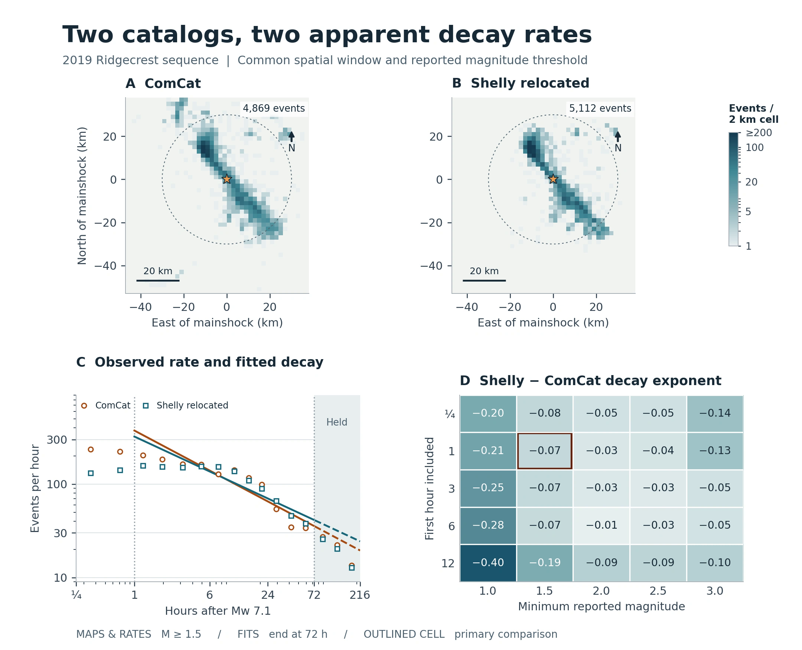

<h1 align="center">
  
</h1>

<p align="center">
  <a href="https://github.com/WUBING2023/PaperSpine/releases/download/v6.0.0-beta.2/paperspine-skill-6.0.0-beta.2.zip"><picture>
    <source media="(prefers-reduced-motion: reduce)" srcset="paperspine5/core/07_发布页/v6/readme/rounded/readme-ticker-still.webp">
    
  </picture></a>
</p>

<p align="center"><strong>От исследовательского вопроса, данных или черновика до редактируемой рукописи с проверяемыми результатами.</strong></p>

<p align="center">
  <a href="#install-with-ai"><strong>Быстрый старт</strong></a> · <a href="#quick-demo">Демонстрация</a> · <a href="#research-cases">Примеры исследований</a><br>
  <small><a href="https://wubing2023.github.io/PaperSpine/v6/">Официальный сайт</a> · <a href="INSTALL-V6.en.md">Инструкция по установке</a> · <a href="#ways-to-work">Выбор версии</a> · <a href="https://lauyanng.github.io/PaperSpine/">Атлас сообщества</a></small>
</p>

<p align="center">
  <a href="https://github.com/WUBING2023/PaperSpine/releases/tag/v6.0.0-beta.2"></a>
  <a href="https://github.com/WUBING2023/PaperSpine/stargazers"></a>
  <a href="LICENSE"></a>
  <a href="https://github.com/WUBING2023/PaperSpine/actions/workflows/validate.yml"></a>
  <a href="https://wubing2023.github.io/PaperSpine/contributors/"></a>
  <a href="https://github.com/WUBING2023/PaperSpine/issues?q=is%3Aissue+is%3Aclosed"></a>
  <a href="https://github.com/WUBING2023/PaperSpine/commits/main/"></a>
</p>

<p align="center">
  <sub>V6</sub>
  <a href="README.md"></a>
  <a href="README.zh-CN.md"></a>
  <a href="README.ja.md"></a>
  <a href="README.ko.md"></a>
  <a href="README.es.md"></a>
  <a href="README.fr.md"></a>
  <a href="README.de.md"></a>
  <a href="README.pt.md"></a>
  <a href="README.ru.md"></a>
</p>

<a id="quick-demo"></a>

## Как исследователи готовят научные статьи

<p align="center">
  <picture>
    <source media="(prefers-reduced-motion: reduce)" srcset="paperspine5/core/07_发布页/v6/readme/rounded/paperspine_codex_demo_v3_15s-still.webp">
    
  </picture>
</p>

<p align="center"><small>Подготовка текста по образцам · Проверка иллюстраций · Предпросмотр статьи · Доработка той же рукописи</small></p>

<a id="workflow"></a>

## Как работает PaperSpine

Используйте опубликованные работы как образец изложения. Выводы обосновывайте данными и анализом собственного исследования.

<p align="center">
  <picture>
    <source media="(prefers-reduced-motion: reduce)" srcset="paperspine5/core/07_发布页/v6/readme/rounded/paperspine-workflow-8s-zh-still.webp">
    
  </picture>
</p>

<p align="center"><small>Исследование и сбор доказательств → Подготовка текста по образцам → Редактируемые иллюстрации → Проверка и передача материалов</small></p>

<a id="install-with-ai"></a>

## Установка с помощью ИИ

Отправьте эту инструкцию ИИ-ассистенту, которым вы пользуетесь.

```text
Установи PaperSpine в ИИ-приложение, которым я сейчас пользуюсь. Сначала прочитай официальную инструкцию по установке.
https://wubing2023.github.io/PaperSpine/v6/llms.txt

Выбери версию с учётом моей задачи и рабочей среды. Проверь контрольную сумму SHA-256 ZIP-архива. После установки подтверди версию и объясни, как вызвать Skill.
```

[Руководство по установке для ИИ-ассистента](https://wubing2023.github.io/PaperSpine/v6/llms.txt) · [Список версий (JSON)](https://wubing2023.github.io/PaperSpine/v6/channel.json)

<a id="ways-to-work"></a>

## Три варианта работы

<a id="start-with-skill"></a>

### Для начала · Skill для всего рабочего процесса

Вызовите `$paper-spine` в чате ИИ-приложения и передайте тему, данные или черновик. Skill подготовит записи об исследовании, анализ, научные иллюстрации и редактируемую рукопись в согласованном объёме.

[**Скачать ZIP**](https://github.com/WUBING2023/PaperSpine/releases/download/v6.0.0-beta.2/paperspine-skill-6.0.0-beta.2.zip) · 

### Для опытных исследователей · Набор Skills

Вызовите `$paper-spine`, чтобы пройти весь процесс, или запустите нужный этап отдельно. Например, `$paper-spine-followwriting` поможет переработать раздел на основе результатов собственного эксперимента, взяв за образец аргументацию опубликованной статьи.

[**Скачать ZIP**](https://github.com/WUBING2023/PaperSpine/releases/download/v6.0.0-beta.2/paperspine-skills-pack-6.0.0-beta.2.zip) · 

### Полнофункциональный плагин · Локальная веб-среда

Установите локальную веб-среду, если хотите увеличивать иллюстрации, просматривать статью или оставлять замечания к доработке в браузере. В эту версию входит полный набор Skills. В Codex под Windows x64 она запускается командой `$paper-spine-web:paper-spine-web`.

[**Скачать ZIP**](https://github.com/WUBING2023/PaperSpine/releases/download/v6.0.0-beta.2/paperspine-web-plugin-6.0.0-beta.2-windows-x64.zip) · 

<details>
<summary><strong>Пять Skills для отдельных этапов и примеры запросов</strong></summary>

| Skill | Пример запроса |
| --- | --- |
| `$paper-spine-study` | Спланируй парный эксперимент на этих данных и сохрани результаты для каждого разбиения. |
| `$paper-spine-followwriting` | Перестрой аргументацию в разделе «Результаты» по образцу этих двух статей. Сохрани мои оценки и границы применимости выводов. |
| `$paper-spine-figures` | Построй векторную иллюстрацию по результатам анализа и приложи код её создания. |
| `$paper-spine-review` | Проверь, какие выводы подкреплены доказательствами, укажи слабые места и внеси правки. |
| `$paper-spine-deliver` | Подготовь редактируемую версию, версию для чтения и сопроводительные материалы. |

</details>

<a id="installation"></a>

## Установка, обновление и удаление

Сверьте контрольную сумму SHA-256 исходного ZIP-архива с файлом контрольных сумм. Распакуйте архив, запустите прилагаемый менеджер установки из папки распаковки и передайте ему путь к исходному ZIP-архиву и полную контрольную сумму SHA-256. После установки откройте новый чат в ИИ-приложении.

```text
python -B edition_manager.py install "<путь к исходному ZIP-архиву>" --sha256 <SHA256>
```

Менеджеру установки требуется Python версии 3.12 или новее. Веб-пакет включает Python для Windows и требует Codex CLI. Менеджер поддерживает автоматическую проверку обновлений, ручное обновление, возврат к предыдущей версии и удаление. Рукописи, данные и локальные задачи при этом сохраняются.

[Инструкция по установке, обновлению и удалению](INSTALL-V6.en.md) · [Файл контрольных сумм SHA-256](https://github.com/WUBING2023/PaperSpine/releases/download/v6.0.0-beta.2/checksums.sha256) · [Релиз V6](https://github.com/WUBING2023/PaperSpine/releases/tag/v6.0.0-beta.2)

## Как PaperSpine связывает доказательства с выводами статьи

- **Определите объём исследования по имеющимся материалам.** Если есть только исследовательский вопрос, сначала выясните, каких доказательств не хватает и какой анализ нужен. Если результаты уже есть, можно сразу перейти к нужной иллюстрации, аргументации или проверке. На следующих этапах используются сохранённые материалы и решения.
- **Указывайте источники для изложения и научных утверждений.** Followwriting сохраняет фрагменты статей-образцов, которые повлияли на структуру и формулировки. Доказательства из собственного исследования определяют, какие утверждения может содержать статья. К рукописи прилагаются проверяемый анализ, исходники иллюстраций и ссылки на источники.
- **Вносите замечания в ту же рукопись.** PaperSpine сохраняет выбранные иллюстрации и замечания. При доработке он продолжает ту же задачу, снова проверяет доказательства, обновляет рукопись и затронутые иллюстрации и сохраняет историю правок.

Эту цепочку можно проверить на примере LIGO. Указанную в статье последовательность прихода сигналов можно проследить до выровненных рядов относительной деформации с двух обсерваторий и до результатов девяти вариантов предварительной обработки. [Доказательства и исходные файлы LIGO](https://wubing2023.github.io/PaperSpine/v6/#gravitational-waves)

<a id="research-cases"></a>

## Быстрое усиление циклонов в Северной Атлантике

В этом исследовании отдельный Skill для всего рабочего процесса использовали для анализа данных NOAA за 42 сезона циклонов. Среди 6 017 сопоставимых 24-часовых окон при пороге 30 узлов доля случаев в более позднем периоде была выше на 0,81 процентного пункта. При повторной выборке по сезонам циклонов 95%-й интервал составил от −1,69 до +3,43 процентного пункта. При пороге 25 узлов точечная оценка стала отрицательной. Иллюстрация из шести панелей объединяет 24-часовую динамику по 484 записям, три непересекающихся диапазона прироста скорости ветра, а также точечные оценки и интервалы для девяти порогов.

<a href="https://wubing2023.github.io/PaperSpine/v6/#showcase"></a>

[Читать статью](https://wubing2023.github.io/PaperSpine/v6/science/research/atlantic-ri/paper.pdf) · [Основная иллюстрация (SVG)](paperspine5/core/07_发布页/v6/science/research/atlantic-ri/figure.svg) · [Проверка устойчивости (SVG)](paperspine5/core/07_发布页/v6/science/research/atlantic-ri/checks.svg) · [Редактируемая рукопись и код анализа](https://wubing2023.github.io/PaperSpine/v6/science/research/atlantic-ri/source.zip)

Переключайтесь между карточками исследований, первой страницей статьи, страницей с результатами, основной иллюстрацией и графиком проверки устойчивости. [Открыть галерею исследований](https://wubing2023.github.io/PaperSpine/v6/?v=research-gallery#showcase)

<a id="edition-field-test"></a>

## Три исследования, три режима работы

Во всех трёх исследованиях использовали открытые данные. Каждое исследование выполнили с GPT‑6.1 Sol тремя способами — с помощью Skill для всего рабочего процесса, отдельных Skills и локальной веб-среды. Всего задокументировано [девять пробных запусков](paperspine5/core/07_发布页/v6/science/research/README.md#how-the-runs-were-conducted). Для каждого исследования доступны статья, оригиналы иллюстраций, код для воспроизведения расчётов и история доработок той же рукописи.

[Посмотреть страницы статей, основные иллюстрации и проверки устойчивости](https://wubing2023.github.io/PaperSpine/v6/#showcase)

### Задержки в миллисекундах при двух слияниях чёрных дыр

Для двух событий из открытых данных LIGO сигнал пришёл в Хэнфорд позже, чем в Ливингстон, на 7,36 и 7,75 миллисекунды соответственно. Порядок прихода сохранялся при всех девяти вариантах предварительной обработки.

<a href="paperspine5/core/07_发布页/v6/science/research/gravitational-waves/figure.svg"></a>

[Читать статью](https://wubing2023.github.io/PaperSpine/v6/science/research/gravitational-waves/paper.pdf) · [Векторная иллюстрация](paperspine5/core/07_发布页/v6/science/research/gravitational-waves/figure.svg) · [Рукопись и код](https://wubing2023.github.io/PaperSpine/v6/science/research/gravitational-waves/source.zip) · [Данные](https://doi.org/10.7935/82H3-HH23)

### Оценка затухания афтершоков зависит от каталога

При одинаковых критериях отбора, от 1 до 72 часов после главного толчка магнитудой Mw 7,1 и с зарегистрированной магнитудой ≥1,5, оценка показателя затухания составила 0,55 для ComCat и 0,48 для каталога событий с уточнёнными координатами Шелли (Shelly).

<a href="paperspine5/core/07_发布页/v6/science/research/ridgecrest/figure.svg"></a>

[Читать статью](https://wubing2023.github.io/PaperSpine/v6/science/research/ridgecrest/paper.pdf) · [Векторная иллюстрация](paperspine5/core/07_发布页/v6/science/research/ridgecrest/figure.svg) · [Рукопись и код](https://wubing2023.github.io/PaperSpine/v6/science/research/ridgecrest/source.zip) · [Данные](https://doi.org/10.5066/P9JN6H0N)

### Дым в июне и два варианта его распределения по регионам

За исходный уровень для каждой станции взяли медиану за 20–22 июня. Разность отклонений PM₂.₅ между Атлантическим побережьем и районом Великих озёр сменила знак, с +74,1 мкг/м³ 6–8 июня до −69,1 мкг/м³ 27–29 июня.

<a href="paperspine5/core/07_发布页/v6/science/research/smoke/figure.svg"></a>

[Читать статью](https://wubing2023.github.io/PaperSpine/v6/science/research/smoke/paper.pdf) · [Векторная иллюстрация](paperspine5/core/07_发布页/v6/science/research/smoke/figure.svg) · [Рукопись и код](https://wubing2023.github.io/PaperSpine/v6/science/research/smoke/source.zip) · [Данные](https://aqs.epa.gov/aqsweb/airdata/download_files.html)

[Материалы по трём режимам работы](paperspine5/core/07_发布页/v6/science/research/README.md) · [Ранние пробные установки](paperspine5/core/07_发布页/v6/science/edition-field-test.md)

<a id="paper-example"></a>
<a id="feature-demos"></a>

## Анимированные демонстрации

<table><tr>
  <td width="50%"><a href="paperspine5/core/07_发布页/v6/science/followwriting-hd.gif"><picture>
    <source media="(prefers-reduced-motion: reduce)" srcset="paperspine5/core/07_发布页/v6/readme/rounded/followwriting-hd-still.webp">
    
  </picture></a><br><strong>Followwriting</strong></td>
  <td width="50%"><a href="paperspine5/core/07_发布页/v6/science/figures-hd.gif"><picture>
    <source media="(prefers-reduced-motion: reduce)" srcset="paperspine5/core/07_发布页/v6/readme/rounded/figures-hd-still.webp">
    
  </picture></a><br><strong>Проверка научных иллюстраций</strong></td>
</tr><tr>
  <td width="50%"><a href="paperspine5/core/07_发布页/v6/science/workbench-hd.gif"><picture>
    <source media="(prefers-reduced-motion: reduce)" srcset="paperspine5/core/07_发布页/v6/readme/rounded/workbench-hd-still.webp">
    
  </picture></a><br><strong>Предпросмотр статьи</strong></td>
  <td width="50%"><a href="paperspine5/core/07_发布页/v6/science/revision-hd.gif"><picture>
    <source media="(prefers-reduced-motion: reduce)" srcset="paperspine5/core/07_发布页/v6/readme/rounded/revision-hd-still.webp">
    
  </picture></a><br><strong>Проверка и доработка</strong></td>
</tr></table>

Ролик Followwriting показывает, как заимствовать приёмы аргументации из опубликованных работ и излагать результаты собственного исследования. Остальные ролики записаны в выпущенной версии веб-среды для Windows. [От замечаний к правкам](https://wubing2023.github.io/PaperSpine/v6/#revision) · [Снимки веб-среды в исходном размере](https://wubing2023.github.io/PaperSpine/v6/#examples)

## Разработка и сообщество

<a href="https://lauyanng.github.io/PaperSpine/"></a>

[Вклад в отдельные обновления V6](https://wubing2023.github.io/PaperSpine/contributors/#v6-contributions) · [Открыть атлас сообщества](https://lauyanng.github.io/PaperSpine/)

[Официальный сайт](https://wubing2023.github.io/PaperSpine/v6/) · [Исходный код V6](paperspine5/core/01_PaperSpine4/src/skill-editions/) · [Менеджер установки](paperspine5/core/06_插件化/release/edition_manager.py) · [Исходный код сайта](paperspine5/core/07_发布页/v6/) · [Сообщить о проблеме](https://github.com/WUBING2023/PaperSpine/issues) · <a id="press-kit"></a>[Медиаматериалы проекта](https://wubing2023.github.io/PaperSpine/v6/science/paperspine-v6-press-kit.zip)

<details>
<summary>Документация и исходный код V5</summary>

- Методы и рабочие материалы · [writing_rationale_matrix](src/skill/references/rewrite.md) · [citation_support_bank](src/skill/references/citation-support-bank.md) · [translation_package](src/skill/references/translation-package.md)
- Инструменты экспорта и проверки · [artifact_check.py](src/scripts/artifact_check.py) · [reference_inventory.py](src/scripts/reference_inventory.py) · [citation_bank_check.py](src/scripts/citation_bank_check.py) · [latex_guard.py](src/scripts/latex_guard.py) · [word_guard.py](src/scripts/word_guard.py)
- Интеграции V5 · [Codex](dist/codex/skills/paper-spine/) · [Claude](dist/claude/skills/paper-spine/) · [OpenClaw](dist/openclaw/skills/paper-spine/) · [Команда Claude](dist/claude/commands/paperspine.md)
- Скрипты установки V5 · [install.ps1](install.ps1) · [install.sh](install.sh)

[Архив V5](https://wubing2023.github.io/PaperSpine/v5/?legacy=1)

</details>

## Лицензия

[MIT](LICENSE) · [Instrument Serif](paperspine5/core/07_发布页/v6/fonts/instrument-OFL.txt) · [Noto Serif SC](paperspine5/core/07_发布页/v6/fonts/notoserifsc-OFL.txt)
